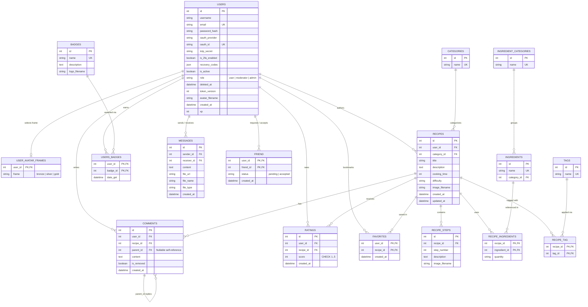

*This project has been created as part of the 42 curriculum by juduchar, cgregoir, nifromon, shanwang.*

# Kumio — Community Recipe Sharing Platform (`ft_transcendence`)

---

## Description

**Kumio** is a full-stack community recipe sharing web application and installable **Progressive Web App (PWA)** developed as the final team project (`ft_transcendence`) of the 42 common core curriculum.

The goal of **Kumio** is to bring cooking enthusiasts together in an interactive, secure, and gamified environment where users can publish step-by-step culinary recipes, have their recipes and ingredients automatically checked for culinary coherence and spelling by a self-hosted local AI model, discover dishes through advanced search and filtering, rate community creations, add friends, see real-time online presence, and chat privately with file sharing.

### Key Features

- **Complete Authentication & Account Security:**
  - Standard registration and login with **JWT** (`access_token` + `HttpOnly` `Secure` `refresh_token` cookie).
  - **OAuth 2.0** remote authentication via the official **42 Intranet API**.
  - **Two-Factor Authentication (2FA)** via **TOTP** (QR code + 6-digit authenticator code) and single-use backup recovery codes.
- **Recipe & Ingredient Management with Local AI Validation:**
  - Creation, edition, and deletion of recipes with cover photos, preparation time, difficulty level, categories, tags, quantified ingredients, and illustrated step-by-step instructions.
  - Automated fail-closed validation of recipes and custom ingredients powered by a **local LLM (`qwen3:4b` via Ollama)** that verifies culinary coherence, ingredient usage across steps, categorization, and French orthography before saving.
- **Advanced Search, Filtering & Sorting:**
  - Full-text search across recipe titles, descriptions, ingredients, and tags.
  - Filtering by recipe category and difficulty level.
  - Sorting by publication/update date, preparation time, or average star rating, with pagination.
- **Social & Real-Time User Interactions:**
  - 1-to-5 star recipe ratings with average score calculation.
  - Friend request workflow (send, accept, decline, cancel, remove) and user discovery.
  - Real-time online/offline friend status and private instant messaging with document attachments powered by **Socket.IO (WebSockets)**.
- **Gamification & Progression System:**
  - Experience points (**XP**) and level progression awarded for community contributions (publishing or rating recipes).
  - Unlockable profile avatar frames and claimable achievement badges.
- **Role-Based Access Control, Administration & Moderation:**
  - Dedicated **Administration** dashboard (user search, account creation, role assignment, suspension with instant JWT/WebSocket revocation, account deletion with GDPR-compliant anonymization) and **Moderation** dashboard (recipe moderation and deletion).
- **Hardened Cybersecurity Infrastructure:**
  - All HTTP/HTTPS and WebSocket traffic is filtered through an **OWASP ModSecurity Core Rule Set (CRS) Web Application Firewall (WAF)** reverse proxy running on **Nginx** with TLS 1.2/1.3 encryption.
  - Sensitive application secrets (database credentials, JWT signing keys) are stored and retrieved dynamically from **HashiCorp Vault** using **AppRole** authentication and a persistent Raft storage backend.

---

## Instructions

### 1. Prerequisites

Ensure the following tools are installed on your host machine or virtual machine:

- **Docker Engine** (`>= 24.0`) and **Docker Compose v2** (`>= 2.20`)
- **GNU Make**
- **Git** & **OpenSSL**
- **Hardware / System resources:**
  - At least **4–6 GB of available RAM** (required to preload and run the local `qwen3:4b` LLM inside the `ollama` container on CPU).
  - Active Internet connection on the first run (to pull Docker images and download the `qwen3:4b` model into the persistent `ollama_data` volume).

### 2. Environment Configuration (`.envs/`)

All service environment files are located in the `.envs/` directory. Start by copying each template (`.example`) file:

```bash
cp .envs/.env.compose.example .envs/.env.compose
cp .envs/.env.db.example .envs/.env.db
cp .envs/.env.vault.example .envs/.env.vault
cp .envs/.env.vault-secrets.example .envs/.env.vault-secrets
cp .envs/.env.backend.example .envs/.env.backend
cp .envs/.env.frontend.example .envs/.env.frontend
cp .envs/.env.waf.example .envs/.env.waf
cp .envs/.env.aimodel.example .envs/.env.aimodel
```


#### Overview of Environment Files

| File | Purpose & Scope |
| :--- | :--- |
| `.envs/.env.compose` | Project name, build contexts and Dockerfile paths, environment file paths, container names, exposed/mapped ports, volumes, networks, and healthchecks. Network names must match the networks declared in `docker-compose.yml`. |
| `.envs/.env.db` | `POSTGRES_USER`, `POSTGRES_PASSWORD`, `POSTGRES_DB`, internal PostgreSQL port (`POSTGRES_PORT`), and `DATABASE_URL`. |
| `.envs/.env.vault` | Vault server/API/cluster addresses, TLS certificates, initialization & secret scripts paths, policies, AppRole paths, Raft storage, and audit logs. |
| `.envs/.env.vault-secrets` | Values consumed by the Vault secret injection scripts (`src/vault/scripts/vault-secrets-*.sh`): database credentials, JWT signing key & expiration, Flask secret key, 42 OAuth credentials, and SMTP settings. |
| `.envs/.env.backend` | Vault AppRole connection paths, Flask secret key, 42 OAuth2 credentials (`FORTY_TWO_CLIENT_ID`, `FORTY_TWO_CLIENT_SECRET`), public `FRONTEND_URL`, and initial seeded accounts (`TEST_*`, `ADMIN_*`). |
| `.envs/.env.frontend` | `VITE_API_URL`: full public origin (e.g., `https://localhost:8443` or `https://localhost`), **without** a `/api` suffix and **without** a trailing slash. |
| `.envs/.env.waf` | Server hostname, HTTP/HTTPS redirect & reverse-proxy ports, Nginx & ModSecurity configuration/log paths, TLS certificate settings, and internal hostnames/ports for the frontend and backend. |
| `.envs/.env.aimodel` | Local LLM runtime configuration |

---

### 3. Installation & Execution

From the root of the repository, build and start all containers using the `Makefile`:

```bash
make up
```

> **Note on first startup:** The `ollama` container downloads and warms up the `qwen3:4b` model before reporting `healthy`. You can follow its progress with `docker compose --env-file .envs/.env.compose logs -f ollama`.

Once all containers are up and healthy, open your browser at:
- **HTTPS (via WAF Reverse Proxy):** `https://localhost:8443` (or `https://localhost` depending on your `WAF_PORT_HTTPS` mapping in `.envs/.env.compose`).

### 4. Available `Makefile` Targets

| Command | Description |
| :--- | :--- |
| `make up` | Builds images and starts all services in detached mode (`docker compose up -d --build`). |
| `make rebuild` | Rebuilds all images without cache and starts the stack. |
| `make down` | Stops and removes containers and networks. |
| `make stop` | Stops running containers without removing them. |
| `make restart` | Restarts all services. |
| `make logs` | Streams real-time logs from all containers. |
| `make insert-secrets` | Runs the Vault secret injection script inside the `vault` container. |
| `make clean` | Stops containers and removes local images, volumes, and orphans. |
| `make fclean` | Full cleanup of all Docker containers, images, volumes, and uploaded files (`src/backend/uploads`). |
| `make re` | Executes `make fclean` followed by `make rebuild`. |

---

## Team Information

The project was built by a team of four students from **42 Perpignan**:

| Team Member (42 Login) | Assigned Role(s) | Responsibilities |
| :--- | :--- | :--- |
| **Julien Ducharlet (`juduchar`)** | **Technical Lead (TL)** & Full-Stack Developer | Technical architecture and full-stack integration; authentication flows; file upload & image optimization pipeline; real-time WebSocket chat & online status; friend management system; PWA configuration; code quality, linters. |
| **Cédric Grégoire (`cgregoir`)** | **Product Owner (PO)** & Full-Stack Developer | Product vision and functional specifications; local AI recipe & ingredient validation service; Role-Based Access Control (RBAC), user administration and content moderation; XP/level progression and unlockable avatar frames; UI design and recipe seed assets. |
| **Nicolas Fromont (`nifromon`)** | **Project Manager (PM)** & DevSecOps Engineer | Project scheduling, meeting organization and meeting; engineering norms & conventions; env files and directories architecture ; Docker & Docker Compose orchestration; Nginx reverse proxy & OWASP ModSecurity CRS Web Application Firewall (WAF) with SSL/TLS generation; HashiCorp Vault containerization, AppRole authentication, and secret management scripts. |
| **Shan Wang (`shanwang`)** | **Database Architect** & Full-Stack Developer | PostgreSQL database schema design and SQLAlchemy 2.0 ORM modeling; initial database seeding system; recipe display, advanced search bar, category/difficulty filtering, multi-criteria sorting (rating, cooking time, update date), and pagination; recipe ratings and achievement badges system. |

---

## Project Management

### Work Organization
- **Agile Iterative Workflow:** The team held regular in-person synchronization and planning meetings at the 42 Perpignan campus. Every meeting was documented with formal **Minutes of Meeting (MoMs)** stored in [`docs/meetings/MoMs/`](docs/meetings/MoMs/) alongside a shared calendar ([`docs/meetings/meetings_calendar.md`](docs/meetings/meetings_calendar.md)).
- **Git Branching & Code Reviews:** Following our documented Git norm ([`docs/norms/Github_norm.md`](docs/norms/Github_norm.md)), the repository used a 3-tier branching strategy:
  - Individual developer branches (`juduchar`, `cgregoir`, `nifromon`, `shanwang`) for feature development.
  - A shared integration branch (`test`) for cross-component testing and conflict resolution.
  - A production branch (`main`) updated only after team review and validation.
- **Standardized Norms:** The team established and voted on written norms in [`docs/norms/`](docs/norms/) covering Docker architecture (`Docker_norm.md`), repository structure (`Structure_norm.md`), documentation (`Documentation_norm.md`), and Conventional Commits (`Github_norm.md`).

### Project Management Tools
- **Trello:** Central hub used throughout the project lifecycle for:
  - **Task Distribution & Kanban Tracking:** Breaking down the project into actionable cards assigned to team members and tracking progress from backlog to validation.
  - **Architectural Decision Matrix (Pros & Cons):** Comparing candidate technologies (frontend frameworks, backend frameworks, relational vs. NoSQL databases, etc.) by listing their advantages, drawbacks, and scoring them in a decision matrix before locking in the stack.
  - **Module Selection & Point Tracking:** Listing, evaluating, and scoring the Major and Minor modules to ensure coherent feature choices and track progressive validation of each module.
  - **General & Technical Requirements Checklist:** Maintaining a dedicated checklist of the subject's mandatory general and technical requirements to verify continuous compliance.
- **GitHub:** Used for version control, branch integration, and commit traceability.

### Communication Channels
- **Slack:** Dedicated workspace organized into specialized channels (documented in [`docs/slack/Slack_Organisation.md`](docs/slack/Slack_Organisation.md)):
  - `#agenda` (task assignments, priorities, and deadlines)
  - `#bugs` (bug reporting, severity tracking, and resolution)
  - `#meetings` (meeting scheduling and MoM links)
  - `#norms` (proposals and team votes on coding/architecture standards)
  - `#ideas` (feature proposals), `#trello` (board updates), `#breaks` (availability), and `#general`.

---

## Technical Stack

### Frontend

| Domain | Technologies Used | Technical Choice |
| :--- | :--- | :--- |
| **Frontend Core** | Vue 3.5, Vue Router 5, Pinia 4, JavaScript | Reusable components, client-side SPA routing with permission guards, and shared reactive state for session, friends, and chat. |
| **Styling & Build Tools** | Tailwind CSS 4, Vite 8 | Utility-first CSS styling and fast development/production bundling environment for the frontend. |
| **PWA** | `vite-plugin-pwa`, Workbox | Web App Manifest, icons, service worker asset caching. |

### Backend

| Domain | Technologies Used | Technical Choice |
| :--- | :--- | :--- |
| **Backend API** | Python 3.12, Flask 3.1, Blueprints | REST API organized by functional domains: auth, users, recipes, ingredients, friends, messages, gamification, and administration. |
| **Authentication** | `bcrypt`, `Flask-JWT-Extended`, `Authlib`, `PyOTP` | Password hashing, short-lived access tokens and `HttpOnly` refresh tokens, 42 OAuth 2.0, and TOTP Two-Factor Authentication (2FA). |
| **Real-Time** | `Flask-SocketIO`, `Socket.IO` client, `Gevent` | Instant message exchange, online status synchronization, and real-time session revocation without page reloads. |
| **File Handling** | `python-magic` | Server-side MIME magic-byte verification. |

### Database

| Domain | Technologies Used | Technical Choice |
| :--- | :--- | :--- |
| **Persistence & ORM** | PostgreSQL 16, SQLAlchemy 2.0.51, Flask-SQLAlchemy 3.1.1 | Recipes, users, and social interactions form structured relations. |

### Cybersecurity, AI & Infrastructure

| Domain | Technologies Used | Technical Choice |
| :--- | :--- | :--- |
| **AI Analysis** | Ollama, `qwen3:4b` | Local analysis of culinary coherence, ingredient categorization, and French spelling. |
| **Proxy & Protection** | Nginx, ModSecurity, OWASP Core Rule Set (CRS), `Flask-Limiter` | HTTPS (TLS 1.2/1.3) entry point, HTTP/WebSocket routing, WAF request filtering, and endpoint rate limiting. |
| **Secrets Management** | HashiCorp Vault 1.19, AppRole, Raft storage | Centralization of sensitive secrets (database, JWT, Flask, OAuth) and automated backend authentication against Vault. |
| **Execution** | Docker, Docker Compose, GNU Make | Isolated services, dedicated bridge networks, and persistent volumes with standardized `Makefile` commands shared across the team. |

---

## Database Schema

> **Note on `comments` and `favorites` tables:**
> The PostgreSQL schema and SQLAlchemy 2.0 ORM (`src/backend/models/comment.py` and `src/backend/models/favorite.py`) define **17 tables** in total. Among them, **15 tables are actively used** by the application, while **`comments` and `favorites` are provisioned at the database/ORM level only (not implemented in the API routes or frontend UI)**.

### Entity-Relationship Diagram



---
### 2. Tables & Relationships
| Table Name | SQLAlchemy Model / Construct | Kind | Relationships & Cardinality | Cascade / Integrity Rules | Status |
| :--- | :--- | :--- | :--- | :--- | :--- |
| **`users`** | `User` (`models/user.py`) | Entity | `1:1` with `user_avatar_frames`<br>`1:N` with `recipes`, `ratings`, `users_badges`<br>`1:N` with `messages` (as `sender` and `receiver`)<br>`N:M` self-referential via `friend`<br>`1:N` with `comments`, `favorites` | `all, delete-orphan` on `avatar_frame_preference` and `badges`; `CHECK (role IN ('user', 'moderator', 'admin'))` | **Implemented** |
| **`user_avatar_frames`** | `UserAvatarFrame` (`models/user_avatar_frame.py`) | Entity (`1:1` extension) | `1:1` child of `users` (`user_id` is both `PK` and `FK`) | `ON DELETE CASCADE` on `users.id`; `CHECK (frame IN ('bronze', 'silver', 'gold'))` | **Implemented** |
| **`friend`** | `Table("friend")` (`models/association.py`) | Join Table (`N:M`) | Self-referential `N:M` between `users.id` (`user_id`) and `users.id` (`friend_id`) | Composite `PK (user_id, friend_id)` | **Implemented** |
| **`badges`** | `Badge` (`models/badge.py`) | Entity | `1:N` with `users_badges` (`N:M` with `users` through `UserBadge`) | `all, delete-orphan` on `users` (`UserBadge`) | **Implemented** |
| **`users_badges`** | `UserBadge` (`models/association.py`) | Association Model (`N:M`) | Links `users` (`N:1`) and `badges` (`N:1`) with payload `date_get` | Composite `PK (user_id, badge_id)` | **Implemented** |
| **`categories`** | `Category` (`models/category.py`) | Entity | `1:N` with `recipes` (one category classifies many recipes) | `UNIQUE` on `name` | **Implemented** |
| **`recipes`** | `Recipe` (`models/recipe.py`) | Entity | `N:1` with `users` (author) and `categories`<br>`1:N` with `recipe_steps`, `recipe_ingredients`, `ratings`<br>`N:M` with `tags` via `recipe_tag`<br>`1:N` with `comments`, `favorites` | `all, delete-orphan` on `steps`, `ingredients`, `ratings`, `comments`, `favorites` | **Implemented** |
| **`recipe_steps`** | `RecipeStep` (`models/recipe_step.py`) | Entity | `N:1` with `recipes` (ordered by `step_number`) | `ON DELETE CASCADE` on `recipes.id` | **Implemented** |
| **`ingredient_categories`** | `IngredientCategory` (`models/ingredient_category.py`) | Entity | `1:N` with `ingredients` | `UNIQUE` on `name` | **Implemented** |
| **`ingredients`** | `Ingredient` (`models/ingredient.py`) | Entity | `N:1` with `ingredient_categories`<br>`1:N` with `recipe_ingredients` (`N:M` with `recipes`) | `all, delete-orphan` on `recipes` (`RecipeIngredient`); `UNIQUE` on `name` | **Implemented** |
| **`recipe_ingredients`** | `RecipeIngredient` (`models/association.py`) | Association Model (`N:M`) | Links `recipes` (`N:1`) and `ingredients` (`N:1`) with payload `quantity` | Composite `PK (recipe_id, ingredient_id)` | **Implemented** |
| **`tags`** | `Tag` (`models/tag.py`) | Entity | `N:M` with `recipes` via `recipe_tag` | `UNIQUE` on `name` | **Implemented** |
| **`recipe_tag`** | `Table("recipe_tag")` (`models/association.py`) | Join Table (`N:M`) | Pure `N:M` join table between `recipes.id` and `tags.id` | Composite `PK (recipe_id, tag_id)` | **Implemented** |
| **`ratings`** | `Rating` (`models/rating.py`) | Entity | `N:1` with `users` and `N:1` with `recipes` | `UNIQUE (user_id, recipe_id)`, `CHECK (score >= 1 AND score <= 5)` | **Implemented** |
| **`messages`** | `Message` (`models/message.py`) | Entity | Dual `N:1` with `users` (`sender_id -> users.id`, `receiver_id -> users.id`) | Requires at least `content` or `file_url` at initialization | **Implemented** |
| **`comments`** | `Comment` (`models/comment.py`) | Entity | `N:1` with `users` and `recipes`; self-referential `1:N` via nullable `parent_id -> comments.id` | Provisioned in ORM/DB schema only | **Not Implemented** *(schema only)* |

---

## Features List

| Feature | Description | Team Member(s) |
| :--- | :--- | :--- |
| **JWT Registration & Login** | Account creation with avatar upload, Bcrypt password hashing, access token + `HttpOnly` refresh token rotation. | `juduchar`,`cgregoir` |
| **OAuth 2.0 (42 Intra)** | Remote authentication with 42 Intra API. | `juduchar` |
| **Two-Factor Authentication (2FA)** | TOTP setup with QR code generation, 6-digit verification, and 8 single-use recovery codes. | `juduchar` |
| **Recipe CRUD & Step Images** | Create, view, edit, and delete recipes with cover photos, dynamic steps, step photos, ingredients, and tags. | `cgregoir`, `shanwang` |
| **Local AI Recipe & Ingredient Analysis** | Automatic validation of recipe coherence, step-ingredient consistency, spelling, and ingredient categorization using local `Ollama` (`qwen3:4b`). | `cgregoir` |
| **Advanced Search, Filters & Sorting** | Search by title, description, ingredient, or tag; filter by category and difficulty; sort by date, duration, or rating with pagination. | `shanwang` |
| **Ratings, Nested Comments & Favorites** | 1–5 star ratings with live average calculation. | `shanwang` |
| **Friends & Online Status** | Friend search/discovery, friend requests, and live online/offline indicator via WebSockets. | `juduchar`, `shanwang` |
| **Real-Time Private Chat & File Sharing** | Instant messaging between friends using Socket.IO rooms with support for uploading and viewing images/documents. | `juduchar` |
| **Gamification (Frames)** | XP bar, level progression, unlockable avatar frames. | `cgregoir` |
| **Gamification (XP, Levels, Badges)** | Claimable badges | `shanwang` |
| **RBAC, Admin & Moderation Dashboards** | `user`, `moderator`, and `admin` permissions; user management (create, edit, role change, suspend, anonymize/delete) and content moderation. | `cgregoir` |
| **PWA (Progressive Web App)** | Installable standalone web app with Web App Manifest and Workbox Service Worker asset caching. | `juduchar` |
| **WAF (Nginx + ModSecurity CRS) & SSL** | HTTPS reverse proxy with automated self-signed certificate generation and OWASP CRS request filtering. | `nifromon` |
| **HashiCorp Vault Secret Management** | Hardened Vault server with Raft storage, AppRole authentication, and automated secret injection for backend services. | `nifromon` |

---

## Modules

In accordance with the `ft_transcendence` subject (**Major Module = 2 pts**, **Minor Module = 1 pt**, minimum **14 pts** required), our team implemented **16 modules** (**5 Major + 11 Minor**) totaling **21 points**:

| # | Module | Type | Points | Team Member(s) |
| :---: | :--- | :---: | :---: | :--- |
| 1 | **Use a frontend framework (React, Vue, Angular, Svelte, etc.)** | Minor | **1 pt** | `juduchar`, `cgregoir`, `shanwang`, `nifromon` |
| 2 | **Use a backend framework (Express, Fastify, NestJS, Django, etc.)** | Minor | **1 pt** | `juduchar`, `cgregoir`, `shanwang`, `nifromon` |
| 3 | **Implement real-time features using WebSockets or similar technology** | **Major** | **2 pts** | `juduchar` |
| 4 | **Allow users to interact with other users** | **Major** | **2 pts** | `juduchar`, `shanwang`, `cgregoir` |
| 5 | **Use an ORM for the database** | Minor | **1 pt** | `shanwang`, `juduchar`, `cgregoir`, `nifromon` |
| 6 | **Progressive Web App (PWA) with offline support and installability** | Minor | **1 pt** | `juduchar` |
| 7 | **Implement advanced search functionality with filters, sorting, and pagination** | Minor | **1 pt** | `shanwang` |
| 8 | **File upload and management system** | Minor | **1 pt** | `juduchar` |
| 9 | **Support for additional browsers** | Minor | **1 pt** | `juduchar`, `cgregoir`, `shanwang` |
| 10 | **Standard user management and authentication** | **Major** | **2 pts** | `juduchar`, `cgregoir`, `shanwang` |
| 11 | **Implement remote authentication with OAuth 2.0 (Google, GitHub, 42, etc.)** | Minor | **1 pt** | `juduchar` |
| 12 | **Advanced permissions system** | **Major** | **2 pts** | `cgregoir` |
| 13 | **Implement a complete 2FA (Two-Factor Authentication) system for the users** | Minor | **1 pt** | `juduchar` |
| 14 | **Content moderation AI (auto moderation, auto deletion, auto warning, etc.)** | Minor | **1 pt** | `cgregoir` |
| 15 | **Implement WAF/ModSecurity (hardened) + HashiCorp Vault for secrets** | **Major** | **2 pts** | `nifromon` |
| 16 | **A gamification system to reward users for their actions** | Minor | **1 pt** | `cgregoir`, `shanwang` |
| | **TOTAL** | **5 Major + 11 Minor** | **21 pts** | |

### Module Implementation & Justification Details


#### • Minor: Use a frontend framework (React, Vue, Angular, Svelte, etc.).
- **Chosen Technology:** `Vue.js 3.5` with `Vue Router 5`, `Pinia 4` and `Vite`.
- **Technical Justification:** Progressive and intuitive Single-File Component architecture chosen for high delivery speed, transparent reactivity, and rapid Vite/PWA integration with a minimal learning curve.
- **Implementation:** Structured across 15 views (`src/frontend/src/views/`) and 18 reusable UI components (`src/frontend/src/components/`), styled with Tailwind CSS v4 and bundled via Vite.

#### • Minor: Use a backend framework (Express, Fastify, NestJS, Django, etc.).
- **Chosen Technology:** `Python 3.12` and `Flask 3.1`.
- **Technical Justification:** Chosen for its flexibility, and robust integration with Python data/AI packages and SQLAlchemy 2.0.
- **Implementation:** Divided into 9 modular Blueprints (`auth_management`, `user_management`, `recipes_management`, `ingredient_management`, `friends_management`, `messages_management`, `gamification_management`, `user_xp_management`, `admin_management`).

#### • Major: Implement real-time features using WebSockets or similar technology.
- **Chosen Technology:** `Flask-SocketIO` and `Gevent`.
- **Subject Requirements:**
  - **Real-time updates across clients:** Live bidirectional transmission of private chat messages, file attachments, and instantaneous friend online/offline presence updates.
  - **Handle connection/disconnection gracefully:** Authenticated JWT handshake on `connect`, active SID tracking per user in `connected_users`, heartbeat pings, and automatic reconnection handling on the client with tab state synchronization.
  - **Efficient message broadcasting:** Avoids expensive global broadcasts by emitting events to targeted Socket.IO private rooms (`user_<id>`) dedicated to specific recipients and active friends.

#### • Major: Allow users to interact with other users. The minimum requirements are:
- **Subject Requirements:**
  - **A basic chat system (send/receive messages between users):** Private real-time messaging between mutual friends with chat history persistence in the `messages` table.
  - **A profile system (view user information):** Public profile view displaying username, bio, equipped avatar frame, current level/XP, earned badges, and authored recipes, alongside personal profile management.
  - **A friends system (add/remove friends, see friends list):** User search/discovery, sending, accepting, declining, canceling friend requests, removing friends, and real-time online status.

#### • Minor: Use an ORM for the database.
- **Chosen Technology:** `SQLAlchemy 2.0.51` with `Flask-SQLAlchemy 3.1.1` and `PostgreSQL 16`.
- **Technical Justification:** Provides strongly typed ORM modeling, safe SQL injection prevention, seamless relationship loading, and transactional integrity.
- **Implementation:** All 17 database tables are mapped as declarative ORM models in `src/backend/models/` with foreign keys, cascade rules, and check constraints.

#### • Minor: Progressive Web App (PWA) with offline support and installability.
- **Chosen Technology:** `vite-plugin-pwa` with Google Workbox (`generateSW`).
- **Technical Justification:** Enables browser-native installation, app shell caching, and offline resilience for static web assets.
- **Implementation:** Configured in `src/frontend/vite.config.js` to generate `manifest.webmanifest`, app icons, service worker caching strategies (`CacheFirst` for static assets, `NetworkFirst` for pages).

#### • Minor: Implement advanced search functionality with filters, sorting, and pagination.
- **Implementation:**
  - **Multi-criteria Search:** Full-text search across recipe title, description, quantified ingredients, and tags.
  - **Filters:** Granular filtering by category and difficulty level.
  - **Sorting:** Multi-directional sorting by update date, cooking duration, or average rating.
  - **Pagination:** Server-side pagination.

#### • Minor: File upload and management system.
- **Subject Requirements:**
  - **Support multiple file types (images, documents, etc.):** Supports avatar and recipe images, as well as chat documents.
  - **Client-side and server-side validation (type, size, format):** Client verifies MIME type and file size before dispatch; server inspects binary magic bytes and enforces strict maximum payload limits.
  - **Secure file storage with proper access control:** Files are renamed using UUIDv4 hashes and stored in isolated subdirectories (`avatars/`, `recipes/`, `steps/`, `chat/`); chat files require verified chat participation to download.
  - **File preview functionality where applicable:** Client-side instantaneous local previews, client-side canvas compression/WebP conversion, and inline step preview.
  - **Progress indicators for uploads:** Visual loading bars and processing indicators during image compression and upload.
  - **Ability to delete uploaded files:** Users can delete or replace avatars, recipe photos, and step images, triggering automatic cleanup of orphaned files from disk.

#### • Minor: Support for additional browsers.
- **Subject Requirements:**
  - **Full compatibility with at least 2 additional browsers (Firefox, Safari, Edge, etc.):** Fully tested and compatible across **Google Chrome / Chromium**, **Mozilla Firefox**, and **Apple Safari**.
  - **Test and fix all features in each browser:** Responsive layouts, flexbox/grid alignments, WebSocket handshakes, and form controls verified without visual breakage.
  - **Document any browser-specific limitations**
  - **Consistent UI/UX across all supported browsers:** Clean visual parity maintained via normalized Tailwind CSS v4 styles and polyfilled standards.

#### • Major: Standard user management and authentication.
- **Subject Requirements:**
  - **Users can update their profile information:** Edit username, email and password from the profile settings view.
  - **Users can upload an avatar (with a default avatar if none provided)**
  - **Users can add other users as friends and see their online status:** Send, accept, reject, cancel friend requests, with live online/offline status updated in real time via WebSockets.
  - **Users have a profile page displaying their information:** Dedicated public profile displaying avatar, username, xp and level, online status, badges, and equipped frame.

#### • Minor: Implement remote authentication with OAuth 2.0 (Google, GitHub, 42, etc.).
- **Implementation:** Standard Authorization Code grant flow via `Authlib` with CSRF state validation, profile data retrieval, and a signed temporary `pending_token` step mandating Terms of Service and Privacy Policy acceptance before initial account provisioning.

#### • Major: Advanced permissions system:
- **Subject Requirements:**
  - **View, edit, and delete users (CRUD):** Comprehensive user CRUD in the Admin dashboard, including admin user creation, role editing, account suspension, and GDPR-compliant account deletion/anonymization.
  - **Roles management (admin, user, guest, moderator, etc.):** Strictly enforced hierarchy (`guest`, `user`, `moderator`, `admin`) protected at database level and API decorator level with immediate token revocation.
  - **Different views and actions based on user role:** Dynamic Vue Router navigation guards.

#### • Minor: Implement a complete 2FA (Two-Factor Authentication) system for the users.
- **Implementation:** TOTP secret key generation (`pyotp`), QR code rendering for authenticator apps (`qrcode`), verification code confirmation on login, and generation of **8 single-use recovery backup codes** securely hashed in the database.

#### • Minor: Content moderation AI (auto moderation, auto deletion, auto warning, etc.)
- **Implementation:** Real-time automated moderation of recipes and ingredients using a local **Ollama (`qwen3:4b`)** LLM. Evaluates culinary plausibility, ingredient consistency across steps, inappropriate content, and French spelling errors. Automatically returns rejection warnings for nonsensical submissions and autocorrects minor orthographical mistakes via structured JSON output.

#### • Major: Implement WAF/ModSecurity (hardened) + HashiCorp Vault for secrets:
- **Subject Requirements:**
  - **Configure strict ModSecurity/WAF:** Nginx reverse proxy compiled with **ModSecurity v3** and the **OWASP Core Rule Set (CRS)** to inspect incoming HTTP/WebSocket traffic, enforce protocol hygiene, and block OWASP Top 10 vulnerabilities (SQLi, XSS, LFI).
  - **Manage secrets in Vault (API keys, credentials, environment variables), encrypted and isolated:** Dedicated **HashiCorp Vault 1.19** instance with persistent Raft storage and TLS encryption, automated unsealing scripts, and **AppRole** authentication delivering database and JWT secrets to the backend dynamically without expose secrets in source code.

#### • Minor: A gamification system to reward users for their actions.
- **Subject Requirements:**
  - **Implement at least 3 of the following (achievements, badges, leaderboards, XP/level system, daily challenges, rewards):**
    1. *XP & Level System:* Users earn +250 XP per published recipe and +50 XP per rating received, with level progression thresholds.
    2. *Achievements & Badges:* Unlockable badges.
    3. *Unlockable Rewards:* Bronze, Silver, and Gold avatar frames unlocked at Levels 2, 4, and 6.
  - **System must be persistent (stored in database):** Persisted across `users.xp`, `badges`, `users_badges`, and `user_avatar_frames`.
  - **Visual feedback for users (notifications, progress bars, etc.):** XP progress bar to level-up.
  - **Clear rules and progression mechanics:** Documented gamification formulas and progression steps accessible on the user profile.

---

## Individual Contributions

### Julien Ducharlet (`juduchar`) — Technical Lead & Full-Stack Developer
- **Contributions:**
  - Designed and implemented the JWT access/refresh lifecycle, **2FA (TOTP QR code + recovery codes)** and **42 OAuth2**.
  - Built the **real-time WebSocket architecture**, friend management system, and live private chat with file attachments.
  - Implemented the **file upload**.
  - Handled git merges and linter compliance.
- **Challenges & Solutions:**
  - *Instant session revocation across stateless JWTs and active WebSockets:* In a stateless JWT architecture, access tokens remain valid until expiration even if an administrator suspends an account, and open WebSocket connections persist, allowing banned users to continue chatting. Resolved by introducing a database-backed `token_version` embedded in JWT claims (invalidating stale tokens on every request via the `@jwt_required` callback) paired with a targeted `force_logout` WebSocket event that immediately disconnects active sockets, purges client-side credentials across all browser tabs via `storage` event synchronization, and redirects the user to the login screen.

### Cédric Grégoire (`cgregoir`) — Product Owner & Full-Stack Developer
- **Contributions:**
  - Designed and implemented the authentication system.
  - Designed and implemented the **Local AI Analysis engine** using `Ollama` (`qwen3:4b`) to validate recipes and ingredients and automatically correct spelling mistakes.
  - Built the **Role-Based Access Control (RBAC)** system, **Admin Users Management**, and **Content Moderation**.
  - Implemented the **XP & Level Rewards system** with unlockable Bronze, Silver, and Gold avatar frames.
  - Created the main UI layouts and curated the initial recipe seed collection and images.
- **Challenges & Solutions:**
  - *Cold-start latency and reliability of the local LLM on CPU:* Running `qwen3:4b` on CPU could cause timeouts on the first recipe submission or fail if network micro-disconnections occurred during model pull. Solved by writing a resilient `docker/aimodel/entrypoint.sh` that retries interrupted downloads, warms up the model into RAM at container startup with `OLLAMA_KEEP_ALIVE=-1`, and blocks backend startup via Docker healthchecks until the model is loaded in memory.

### Nicolas Fromont (`nifromon`) — Project Manager & DevSecOps Engineer
- **Contributions:**
  - Designed and deployed the **Web Application Firewall (WAF)** container integrating **Nginx**, **ModSecurity v3**, **OWASP Core Rule Set (CRS)**, custom whitelist/blacklist/hardening rules, and automated self-signed TLS certificate generation.
  - Built the **HashiCorp Vault** infrastructure with Raft storage, TLS encryption, automated initialization/unsealing, and **AppRole** secret distribution for the backend.
  - Structured the `docker-compose.yaml` architecture and `.envs/` configuration hierarchy.
  - Coordinated team meetings, authored the **Minutes of Meeting (`MoMs`)**, and wrote the project norms (`docs/norms/`, `docs/slack/`).
- **Challenges & Solutions:**
  - *Automating Vault initialization, unsealing, and AppRole secret delivery across container restarts:* Vault starts sealed by default and requires dynamic RoleID/SecretID generation. Overcame this by creating modular shell libraries (`lib/vault/`) and entrypoint scripts that automatically initialize/unseal Vault, configure policies and AppRoles, and share valid credentials with the backend container through a dedicated volume.

### Shan Wang (`shanwang`) — Database Architect & Full-Stack Developer
- **Contributions:**
  - Architected the **PostgreSQL database schema** and implemented the **SQLAlchemy 2.0 ORM models** and database seeders.
  - Developed the **recipe listing, advanced search bar, filtering (category, difficulty), multi-criteria sorting (rating, cooking time, update date), and pagination**.
  - Implemented the **recipe rating system** and the **achievement badges**.
- **Challenges & Solutions:**
  - *Translating the recipe-list SQL query into SQLAlchemy ORM without breaking pagination:* Combining search across recipe fields, ingredients, and tags with filters and rating-based sorting made it easy for joins to duplicate recipes or skew the result count. I used ORM relationship predicates for ingredient and tag searches, a correlated AVG subquery for rating sort, and counted the filtered query before applying pagination.

---

## Resources

### References & Documentation
- **Frontend:** [Vue.js 3 Documentation](https://vuejs.org/guide/introduction.html), [Vue Router](https://router.vuejs.org/), [Pinia](https://pinia.vuejs.org/), [Tailwind CSS v4](https://tailwindcss.com/docs), [Vite PWA Plugin](https://vite-pwa-org.netlify.app/).
- **Backend & ORM:** [Flask Documentation](https://flask.palletsprojects.com/), [SQLAlchemy 2.0 Unified Tutorial](https://docs.sqlalchemy.org/en/20/tutorial/), [Flask-JWT-Extended](https://flask-jwt-extended.readthedocs.io/), [Flask-SocketIO](https://flask-socketio.readthedocs.io/), [Authlib OAuth 2.0](https://docs.authlib.org/).
- **Security & DevSecOps:** [OWASP ModSecurity Core Rule Set](https://coreruleset.org/docs/), [HashiCorp Vault AppRole Auth Method](https://developer.hashicorp.com/vault/docs/auth/approle), [RFC 6238 (TOTP: Time-Based One-Time Password Algorithm)](https://datatracker.ietf.org/doc/html/rfc6238), [42 Intranet OAuth2 API Guide](https://api.intra.42.fr/apidoc/guides/web_application_flow).
- **Local AI Runtime:** [Ollama API Documentation](https://github.com/ollama/ollama/blob/main/docs/api.md).

### How AI Was Used in This Project
**As an Embedded Application Feature (Local AI Validation Module):**
   - The platform integrates a self-hosted **Qwen3 4B (`qwen3:4b`)** model running locally inside the `ollama` Docker container.
   - It is used exclusively in `src/backend/recipes_management/analysis.py` and `src/backend/ingredient_management/analysis.py` to validate user-submitted recipes and ingredients (checking culinary plausibility, verifying that ingredients mentioned in steps match the ingredient list, validating category consistency, and automatically fixing French spelling/grammar typos via structured JSON responses).